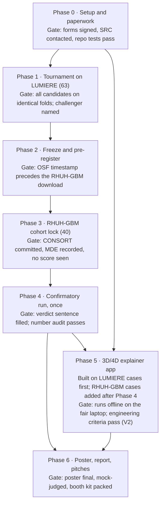

# gbm-rec — Complete Project Plan (LACSEF)

Oct 29, 2026 · @sophie

> Repository copy of the shared doc at https://claude.ai/artifact/7jD9jT6FFKRUhkA4Ljft7g, exported 2026-10-29. The shared doc is where edits happen; re-export to refresh this copy. `docs/plan/final_plan.docx` remains the authoritative plan.

## 1. Executive summary

**The project in one sentence.** gbm-rec runs a pre-registered, eight-model tournament to test whether MRI-based models predict where glioblastoma recurs better than plain distance from the tumour, then confirms the winner exactly once on 40 patients no model has seen, and shows the result in a 3D/4D web app.

This document is the complete build guide for the LACSEF team. It is derived from `docs/plan/final_plan.docx`, which stays the authoritative plan; where the two differ, the .docx wins. It deliberately has no dates.

### The problem

Glioblastoma is the most common malignant brain tumour in adults. After surgery, radiotherapy treats the tumour bed plus a safety margin. The 2023 ESTRO-EANO guideline recommends a uniform 15 mm margin, trimmed only at anatomical barriers (skull, falx, ventricles). The same guideline leaves one question open: FLAIR-abnormal tissue around the tumour "may represent non-enhancing tumour and should be considered for inclusion". Nobody has settled whether a margin shaped by MRI would catch more recurrence than a uniform one at the same treated volume.

### The question

**Can MRI-based models beat distance?** Every analysis, figure and app screen answers that one question. Each 1 mm voxel of brain outside the treatment target gets a recurrence score; the models are judged on how well those scores rank the voxels where the tumour actually came back.

### What we build

| Component | What it is | Why it impresses a judge |
| --- | --- | --- |
| Model tournament | Eight candidates, from a one-line distance rule (C0) to a 3D convolutional network (C5) and a rank-average ensemble (C6), all scored on identical patient-grouped folds of 63 LUMIERE patients | A fair, controlled comparison along a complexity axis, not one model shown off alone |
| Pre-registration | Every rule, threshold, model hash and result sentence posted to OSF before the test data is downloaded | Proves the test was not tuned to the answer; checkable from two timestamps |
| Sealed confirmatory test | The frozen challenger vs distance on 40 RHUH-GBM patients, run once; a marker file makes a second run impossible | External validation, which most published models in this area lack |
| Statistics | Per-patient PR-AUC, lift over chance, matched-volume coverage; bias-corrected bootstrap CIs; power simulation; false-discovery-rate control | Graduate-level methods, each with a stated reason |
| Reproducibility system | Stable seeds, a run manifest on every result, clean-tree checks, hashed models, an automated number audit | Every number on the poster can be traced to a commit and a file |
| 3D/4D explainer app | A static website: rotate a real patient's brain, see each model's prediction, then reveal where the tumour came back; step through scans over time | The booth's centrepiece; opens on a judge's phone from a QR code |

### The headline number

**Coverage at matched volume:** when a model and the 15 mm guideline margin treat exactly the same volume of brain, what share of the recurrence (outside the target) does each catch? Anyone can understand it in five seconds. The registered primary endpoint is ΔPR-AUC versus distance, because it scores the ranking at every volume and has more statistical power.

### How the champion is decided

The best non-distance candidate on LUMIERE becomes the challenger by a pre-written rule. It is named **champion** only if its ΔPR-AUC over distance on RHUH-GBM has a 95% CI lower bound above zero. Otherwise distance is champion. Four outcomes are named in advance (challenger champion, bounded null, inconclusive, challenger worse), each with a finished poster sentence.

### Why it is strong whichever way the result falls

The predecessor study (gbm-4d) found every added model gained less than about 0.015 PR-AUC over distance on LUMIERE. The most likely result here is that distance holds. The design treats that as a complete answer: a tightly bounded null on an external cohort is evidence about where recurrence occurs, and it is reported with its achieved power. The strength of the project is the rigour of the comparison, not a claim to a new algorithm.

### Current state (from the repository, last updated 2026-09-24)

- Code for all phases is written and unit-tested on synthetic data (104 tests passing at last record); the app has five working screens.
- Features are extracted for all 63 LUMIERE patients (53 evaluable).
- **No candidate has been scored, and no RHUH-GBM file exists.**
- Open items: ISEF forms (Step 0.1), tournament rules D6 points (a)–(j), proposals D9–D15, the C5 hardware/weights decision.

> Fixed label on every deliverable: "Research visualization of a pre-registered method comparison on public data. Not a treatment prediction."

## 2. Background and scientific rationale

Distance from the tumour is the model to beat, and two finished, frozen predecessor studies already narrow what can beat it. This project reuses their code and findings and re-fits nothing from them.

### Key terms

| Term | Plain meaning |
| --- | --- |
| Glioblastoma (GBM) | Aggressive primary brain tumour; it almost always recurs, usually near the original site |
| T1ce (T1c) | Contrast-enhanced T1 MRI; bright where the blood–brain barrier is broken (enhancing tumour) |
| FLAIR | MRI sequence showing oedema and non-enhancing infiltrated tissue as bright |
| Target | Baseline enhancing tumour + resection cavity: the region the margin is drawn around |
| RANO progression | Standardised criteria for declaring that the tumour has come back or grown |
| Registration | Aligning two scans so the same voxel means the same anatomy; used to carry the recurrence label back onto the baseline scan ("label transport") |
| PR-AUC | Area under the precision–recall curve; good for rare positives such as recurrent voxels |
| Voxel | A 1 mm × 1 mm × 1 mm cube of the 3D image |

### What the predecessor studies found

| Finding | Source | Consequence here |
| --- | --- | --- |
| Distance predicts recurrence location; habitats, the Fisher–KPP PDE and a hybrid each add < \~0.015 ΔPR-AUC | gbm-4d (LOPO n = 42, sealed test n = 11) | Distance is the comparator |
| 45.2% of recurrent enhancing tissue lies inside the target; 86% of patients recur within 2 cm | gbm-4d | Any gain will be small |
| The PDE converged to maximum diffusion and minimum proliferation (40 of 42 fits): a smoothed distance map | gbm-4d RQ2 | The PDE appears in the app as an animation only |
| Adding feature blocks to LightGBM made scores slightly worse at each step | gbm-4d RQ1 | Candidates stay small; the simpler model wins ties |
| Baseline FLAIR-abnormal tissue showed the largest spatial effect: RR 7.29 (4.73–16.44) and 3.22 (1.68–5.88) | gbm-wm §4.4, §5 | The main new feature; always described as an association on 9–13 patients |
| White matter did not replicate: RR 0.94 (0.54–1.34) | gbm-wm §4.2, §5 | White matter is excluded from every candidate |
| A registration threshold written for one recipe removed 21 of 72 patients when another recipe ran | gbm-wm §3.6 | Screen thresholds are fixed against the recipe that will actually run |

### Why this is worth doing

If recurrence follows baseline FLAIR abnormality, a FLAIR-shaped margin would catch more recurrence at the same treated volume, which would bear directly on the guideline's open sentence. If it does not, the uniform margin rests on better evidence from an external cohort. Either answer is useful.

### Literature positioning (plan Step 0.6)

A capped scan of up to 25 PubMed papers on voxel- or region-level recurrence-location prediction places the project. The search string and extraction form (`docs/literature/`) are committed **before** reading. For each paper record: cohort size and imaging inputs; external validation (yes/no); whether a distance baseline is reported; metric and headline number; pre-registration (yes/no). Report the counts exactly as found. The table becomes the poster's context panel. The 25-paper cap rule still awaits team approval.

## 3. Research question, hypotheses and pre-registration

One primary question, one primary test, and every rule fixed before the test data exists.

### Question

Do MRI-based models add predictive information about where glioblastoma recurs beyond distance from the tumour, on an independent cohort, and does more model complexity buy more?

### Hypotheses

- **H0 (null):** the challenger's mean per-patient PR-AUC on RHUH-GBM is no higher than distance's (Δ ≤ 0).
- **H1:** the challenger's ΔPR-AUC over distance is above 0, shown by a 95% BCa CI lower bound above 0.
- **Complexity trend (descriptive):** ΔPR-AUC vs distance for all eight candidates, ordered simplest to most complex.
- **Stated expectation:** distance most likely remains champion, with challengers bounded to a small margin.

### Why a tournament and a separate confirmation

Picking the best of several models and scoring it on the same data inflates its score, because the winner is partly the model that got lucky. Choosing on LUMIERE and scoring once on RHUH-GBM removes that inflation. A judge can verify the order from the OSF timestamp and the download date committed to the repository.

### The protocol, end to end

1. Write the tournament rules into `DECISIONS.md` (D6) and commit them, with the master seed.
2. Score every candidate on identical 7-fold patient-grouped LUMIERE folds.
3. Name the challenger by the selection rule.
4. Refit every learned candidate on all 63 patients; SHA-256-hash the weights.
5. Run the power simulation; fix registration thresholds and RHUH-GBM rules.
6. Post everything to OSF.
7. Download RHUH-GBM only after the OSF timestamp; commit the download date and archive hash.
8. Lock the RHUH-GBM cohort (CONSORT table, achieved MDE) without computing any score.
9. Run the confirmatory script once; it checks hashes, writes an irreversible marker and refuses a rerun.
10. Apply the verdict rule and fill the pre-written sentence.

### Pre-written result sentences

- *Challenger wins:* "On an independent cohort, \[challenger\] adds \[Δ\] PR-AUC (95% CI \[...\]) over distance from the treatment target, and at the volume of the 15 mm guideline margin captures \[x\]% of recurrence against \[y\]% for distance."
- *Distance holds:* "On an independent cohort, the best challenger from an eight-model tournament adds less than \[upper limit\] PR-AUC over distance, and at the volume of the 15 mm guideline margin captures \[x\]% of recurrence against \[y\]% for distance; distance remains the best available predictor."
- *Metrics disagree:* "The verdict follows the pre-registered primary, PR-AUC, which \[does / does not\] favour \[challenger\]. At the guideline margin's volume alone, coverage \[does / does not\] differ (\[x\]% vs \[y\]%, 95% CI \[...\]); the difference is reported as a secondary result."

### OSF pre-registration checklist

- [ ] Tournament leaderboard and the named challenger, with the commit hash
- [ ] SHA-256 hashes of every refit model
- [ ] Feature definitions and the label mapping for each cohort
- [ ] Cavity rule and label-verification rule
- [ ] Registration recipe, screen thresholds and exclusion rules
- [ ] Power table
- [ ] Primary, verdict rule, secondaries, sensitivity and exploratory lists
- [ ] All result sentences
- [ ] Statement of what was seen before posting: all LUMIERE results, both predecessor studies, the RHUH-GBM dataset paper, and no RHUH-GBM image

Draft: `docs/preregistration.md`.

## 4. Datasets

Two public, de-identified cohorts with fixed roles: LUMIERE develops and selects; RHUH-GBM confirms, once.

|  | LUMIERE | RHUH-GBM |
| --- | --- | --- |
| Role | Development only (deviation V1) | Confirmatory; the only numbers called *validation* |
| Patients | 63 locked (53 evaluable at feature extraction) | 40 enrolled; evaluable n set at cohort lock |
| Licence | CC0 | CC BY 4.0 (open NIfTI + clinical CSV); controlled DICOM not used |
| Source of inputs | gbm-4d's frozen derived data, baseline space, transported labels (D5) | TCIA collection, doi:10.7937/4545-c905; 2.9 GB open files |
| Scans used | Post-op baseline + each segmented RANO progression (median 3) | Pre-op, early post-op (< 72 h), recurrence |
| Labels | DeepBraTumIA automated labels, mapping verified by gbm-4d `02_verify_labels.py` | 1 = necrosis, 2 = oedema + non-enhancing, 3 = enhancing (dataset paper); hand-corrected |
| Preprocessing | N4, rigid to T1c, z-score in brain mask | SynthStrip, SRI24 atlas, z-score |
| Status | Features done for 63 of 63 | **Not downloaded. Must not be downloaded before the OSF timestamp.** |

### Endpoint and evaluation region

- **Label:** enhancing tumour at the first segmented RANO progression (LUMIERE) or the recurrence scan (RHUH-GBM), transported into baseline space.
- **Evaluation region:** brain minus the target.
- **Undefined patients:** a patient with no enhancing recurrence outside the target is *undefined*, never scored as zero, and is reported in the CONSORT table.

### RHUH-GBM rules settled before download (plan Step 2.2)

| Open point | Pre-registered rule |
| --- | --- |
| How the resection cavity is labelled on the early post-op scan | Inspect label values inside the cavity on 5 seeded patients. If unlabelled, target = post-op enhancing residual + the preoperative tumour core (labels 1 + 3), carried rigidly into post-op space and clipped to the brain mask; recorded as a deviation |
| Label mapping in the files could differ from the paper | Re-derive the mapping from intensities as gbm-4d did; this check may only correct a swapped mapping, never choose between alternatives |

### Access rules (hard)

- No data download of any kind before the ISEF forms are signed.
- `config.yaml: data.rhuh_gbm.local_root` stays `null` until OSF is posted; a test enforces it.
- Download only the open files; commit the download date and the archive SHA-256.
- Data never goes into git; the resolved data path goes into every run manifest.
- Credit both datasets on the poster, in the app and in the report.

## 5. Image processing and registration

The recurrence label lives on a later scan, so it must be carried back onto the baseline scan by deformable registration before any voxel can be scored. Registration quality is the project's largest technical risk, so it is screened four ways and tested on known deformations.

### Label transport

- **LUMIERE:** reuse gbm-4d's transported labels exactly (frozen code at commit `eeba777`). Later progressions are transported with the same frozen scripts (D9, proposed).
- **RHUH-GBM:** deformable SyN registration driven by T1ce, resection cavity masked out of the similarity metric, carrying the recurrence segmentation into the early post-op grid.

| Choice | Primary | Sensitivity |
| --- | --- | --- |
| Recipe | gbm-wm's tuned SyN settings (1.39 mm residual on synthetic deformations vs 2.13 mm for the original) | gbm-4d's original recipe, which made the LUMIERE labels |
| Round-trip exclusion threshold | Fixed before OSF from the tuned recipe's round-trip distribution on LUMIERE baseline→progression pairs (uses no LUMIERE labels; D12) | The unscreened arm |

The recipes differ because gbm-wm found the original recovered only 0.6 mm of a 2.7 mm known deformation. The mismatch is logged as a deviation and measured by the sensitivity row.

### Registration screens (can exclude, never certify)

- [ ] Round-trip error per patient (peritumoral median and maximum), Jacobian statistics, folded-voxel count
- [ ] Brain-surface distance against the shipped brain masks, with the identity transform as a null
- [ ] Multi-arbiter consensus: recipe re-driven by T2 and FLAIR, plus the shipped atlas alignment
- [ ] Simulated deformation recovery on 10 seeded patients

No screen number is ever called a TRE (target registration error); TRE was never measured.

### Exclusions, each logged with its reason

Missing sequence or segmentation · failed transport · screen failure · empty target · no enhancing recurrence outside the target (undefined). The CONSORT table runs from 40 enrolled to the evaluable count.

### Known shifts between cohorts

- FLAIR labels are automated in LUMIERE and hand-corrected in RHUH-GBM: a shift that works against FLAIR-based challengers.
- Image preprocessing differs (see §4). C0–C4 use only masks and are unaffected; C5 reads intensities, so this is logged as a source of shift for C5.

### Compute notes (from the repository)

- Smoke run of the threshold study (`07_`) on Patient-001: round-trip median 0.77 mm, 2,932 s; all 63 pairs ≈ 51 h on one thread.
- Later-progression transport (`05_`) ≈ 25 h on one thread.
- The laptop has ≈ 2 GB RAM free, so long jobs run on the second PC: `08_pack_bundle.py --zip` → `RUN.bat both 3` → `09_import_bundle.py`. ITK threads stay pinned to 1.

## 6. Features and candidate models

Five voxel features feed eight candidates, ordered from simplest to most complex. That order breaks ties and sets the x-axis of the headline forest plot.

### Features (computed per voxel, `src/gbmc/features.py`)

| # | Feature | Definition | Source |
| --- | --- | --- | --- |
| f1 | Distance to target | Signed Euclidean distance (mm) to the surface of baseline enhancing tumour + cavity | gbm-4d Block A |
| f2 | FLAIR-abnormal membership | 1 inside the baseline oedema/non-enhancing label, else 0 | Verified label mapping |
| f3 | Distance to FLAIR edge | Signed Euclidean distance (mm) to the surface of the f2 region | New |
| f4 | Interaction | f1 × f2 | New |
| f5 | Geodesic distance | Shortest path from the target respecting falx, ventricles and skull | gbm-4d Block B |

Native voxel spacing is not a feature (D7): RHUH-GBM's open files are resampled to 1 mm. White matter is excluded (did not replicate in gbm-wm).

### Candidates (`src/gbmc/candidates.py`)

| ID | Candidate | Inputs | Learner | Why it is in |
| --- | --- | --- | --- | --- |
| C0 | Distance | f1 | None: score = −f1 | The clinical margin as a ranking; always the comparator |
| C0T | Trimmed distance | f1 + ESTRO-EANO barriers (stop at skull and falx, cut to 5 mm at ventricles) | None | The guideline margin as a ranking |
| C4 | FLAIR edge | f3 | None: score = −f3 | Does the oedema boundary alone rank better? |
| C1 | Distance + FLAIR, linear | f1–f4 | L2 logistic regression, patient-balanced weights | Four coefficients; overfits least |
| C3 | + anatomy, linear | f1–f5 | L2 logistic regression | Do anatomical barriers add to C1? |
| C2 | Distance + FLAIR, non-linear | f1–f4 | LightGBM, gbm-4d's frozen hyperparameters | Does a non-linear learner extract more? |
| C5 | 3D CNN (gated) | T1c, FLAIR (z-scored), target mask, FLAIR mask, f1 map | Small patch-based 3D U-Net, pretrained if usable weights exist | Answers "why not deep learning?" with a number |
| C6 | Rank-average ensemble | Scores of C1, C3, C2 (+ C5 if run) | None: mean within-patient percentile rank | Does combining learned models beat the best one? |

### C5 rules (no leakage, no hidden tuning)

- **Gate (Step 0.4):** runs only if a CUDA GPU with ≥ 8 GB is available. The laptop has none (Intel Arc, \~2 GB); the second PC is unchecked. If no GPU, C5 is dropped and the decision recorded.
- **Weights:** pretrained 3D tumour-segmentation weights with a reuse licence if verified, else from scratch. Candidates found (unverified, not downloaded): nnU-Net v2 BraTS 2021 (Zenodo 10.5281/zenodo.11582627, CC BY 4.0); MONAI `brats_mri_segmentation` (Apache 2.0). These expect 4 channels, so the first layer needs adapting. `TODO: verify` licences and BraTS data terms.
- Fixed epoch count chosen before training (no early stopping on a validation fold); augmentation = left–right flips and rotations ≤ 10°; one seed per fold; weighted loss for the rare class; PyTorch deterministic flags.

### C6 rules

1. Membership fixed in advance: C1, C3, C2, plus C5 if it runs.
2. Per patient, each member's scores in the evaluation region become percentile ranks 0–1 (ties share the average rank).
3. C6 = unweighted mean of members' ranks.
4. In cross-validation, C6 averages the members' held-out predictions, so it sees no held-out labels.
5. C0 is not a member (every member already uses f1).

Weighted stacking is left out (D8): it needs nested cross-validation, and \~54 training patients per fold would make its weights noisy.

## 7. Tournament, metrics, statistics and verdict

All candidates are scored on the same seeded folds with the same endpoint; the challenger and the champion are both named by rules written before any score is seen.

### Folds

One patient-grouped 7-fold split (9 patients per fold) drawn with `stable_seed` (BLAKE2b) from `seeds.master`, shared by every candidate. `seeds.master` is `null` until the rules are committed.

### Metrics (per held-out patient, then averaged)

| Metric | Definition | Why |
| --- | --- | --- |
| PR-AUC (primary) | Area under the precision–recall curve, brain minus target | Registered endpoint; suits rare positives; continuous with gbm-4d |
| Lift over chance | PR-AUC ÷ the patient's recurrence prevalence | Makes a PR-AUC near 0.07 readable as "x times better than guessing" |
| Coverage at matched volume | Share of recurrence outside the target in the model's top-ranked voxels, when it treats exactly that patient's 15 mm margin volume; also at 20 mm and 50 ml | The headline: same treated volume, more recurrence caught? |

Coverage is always stated with its denominator (all recurrence, or recurrence outside the target).

Per-patient lift and the matched-volume coverage, written as formulas:

```latex
\text{Lift}_i = \frac{\text{PR-AUC}_i}{\pi_i}, \qquad \text{Coverage}_i(V) = \frac{|R_i \cap \text{Top}_i(V)|}{|R_i|}
```

where π\_i is patient i's recurrence prevalence, R\_i the recurrent voxels outside the target, and Top\_i(V) the model's highest-scoring voxels totalling volume V.

### Statistics (`src/gbmc/stats.py`)

- Each candidate's mean and Δ vs C0 with a **patient-level BCa bootstrap 95% CI** (1000 resamples).
- **Power simulation** (`gbmc.power`, `04_`): minimum detectable effect at 80% power under the actual decision rule, at 20, 25, 30 and 35 evaluable patients, from C0's LUMIERE scores only. gbm-4d's reference: 0.05 at n = 42, 0.08 at n = 11.
- **BH-FDR** at q = 0.05 over the secondary family only.

### Selection rule (LUMIERE)

The challenger is the candidate among C4, C1, C3, C2, C5, C6 with the highest mean held-out PR-AUC. A more complex candidate wins only by more than **0.005**; within that margin, the simpler one is chosen. The challenger goes forward whether or not it beat C0 on LUMIERE.

### Verdict rule (RHUH-GBM)

| Outcome | Condition | Poster says |
| --- | --- | --- |
| Challenger champion | CI lower bound > 0 | The challenger improves on distance by \[Δ\] on an unseen cohort |
| Bounded null | CI contains 0; upper bound < MDE | Distance holds; challengers add less than \[upper bound\] |
| Inconclusive | CI contains 0; upper bound ≥ MDE | Distance holds; the cohort was too small to bound the challengers tightly |
| Challenger worse | CI upper bound < 0 | Distance beats the best learned model on new patients |

### Analysis families on RHUH-GBM

- **Primary:** challenger vs C0, Δ mean PR-AUC.
- **Hero secondary (shown first everywhere):** challenger vs C0 on matched-volume coverage at each patient's 15 mm margin volume.
- **Complexity trend:** every candidate vs C0, as one forest plot.
- **Other secondaries (BH-FDR):** every other candidate vs C0; challenger vs C0T; challenger vs C0 in the escape region (> 20 mm); lift over chance; coverage at 20 mm and 50 ml.
- **Descriptive only:** per patient, the share of recurrence beyond 15 mm and 20 mm and the share each model catches.

Open points D6 (a)–(j) must be resolved and committed before `02_tournament.py` runs.

## 8. Confirmatory run, sensitivity and exploratory analyses

The frozen models are applied once to the locked RHUH-GBM cohort; nothing is tuned, reselected or rerun.

### Confirmatory run (`scripts/30_confirm.py`, `src/gbmc/confirm.py`)

1. Compute f1–f5 in each patient's early post-op grid; derive falx and ventricle barriers as gbm-4d did, adapted from MNI to SRI24 space (record the adaptation as a decision first).
2. **Hash check:** load each model, recompute SHA-256, stop on any mismatch with OSF.
3. **Run once:** write an irreversible marker on first reading RHUH-GBM labels; refuse any second run.
4. Score every candidate on every evaluable patient.
5. Apply the verdict rule; fill the matching sentence; classify the outcome.
6. Export for the app: per patient and candidate, the probability map (NIfTI float16), top 50 ml and 100 ml masks, per-patient PR-AUC and coverage, to `results/confirm/maps/` with a manifest.

### Sensitivity analyses (`31_sensitivity.py`)

| Analysis | What it tests |
| --- | --- |
| Unscreened arm | Whether registration screening changed the answer |
| gbm-4d's original registration recipe | The recipe mismatch with LUMIERE labels |
| Alternative cavity definition | The cavity rule |
| Label = enhancing + necrosis | The endpoint definition |
| 11 secondary-facility patients removed | Scanner/site effects |

### Exploratory (labelled exploratory everywhere)

- **The fourth dimension (LUMIERE, Step 1.8):** score each candidate's out-of-fold map on the *new* enhancing voxels at the second and third progressions. Does a map trained on where the tumour came back also rank where it spreads next? Drives the app's time slider.
- **C1 + baseline ADC**, fitted leave-one-patient-out inside RHUH-GBM (LUMIERE has no ADC).

### Figures (`50_figures.py`, `51_reveal_figure.py`)

| Figure | Content | Takeaway |
| --- | --- | --- |
| Prediction vs reality (centrepiece) | One rule-chosen patient (median per-patient Δ): 15 mm margin, distance prediction, champion prediction, actual recurrence; both predictions at the margin's volume, coverage under each | What "beat distance" looks like in a real brain |
| Does more complexity help? | Forest plot: eight models in complexity order on x; ΔPR-AUC vs distance with 95% CI on y; zero line = distance; LUMIERE points faint | The answer in five seconds |
| The truth test | Protocol strip: 63 patients → tournament → freeze → hash → OSF → 40 new patients → one run → reveal, with OSF and download dates | Why the result can be trusted |
| Hero metric | Matched-volume coverage: guideline margin, distance, champion, with CIs | The number a judge remembers |
| Where distance fails | Per-patient share of recurrence beyond 15 and 20 mm, and what each model catches | Where a better model would have to win |
| Coverage curve | Coverage vs treated volume, champion vs C0 | Whether it holds at every volume |
| Per-patient strip | Each patient's Δ, ordered; demo and failure cases marked | Whether one patient drives the mean |
| Later progression | Rank of new tumour at each later timepoint | The fourth dimension, exploratory |

Every figure is generated from `results/`; none is drawn by hand.

### Number audit (`41_audit_numbers.py`)

Reads every number in the poster, report and app text and checks it against the JSON results, and checks the language rules (§13). It must pass before anything is printed.

## 9. Software architecture and reproducibility

The analysis is a Python library (`gbmc`) driven by numbered scripts, one per stage; code enforces the rules so they hold under deadline pressure.

### Environment

Python 3.13.14; gbm-4d's lockfile (LightGBM 4.7.0, scikit-learn 1.9.0, SimpleITK 2.5.6, numpy 2.5.2) + scikit-image + trimesh; PyTorch only if the C5 gate passes. `gbm4d` installed `--no-deps` pinned at commit `eeba777`. No other dependencies without team approval.

```bash
"<python 3.13.14>" -m venv .venv
.venv/Scripts/python -m pip install -r requirements.lock
.venv/Scripts/python -m pip install --no-deps "gbm4d @ git+file:///<path>/gbm-4d@eeba7779804412b0a32d0b5ba0f23c3156448549"
.venv/Scripts/python -m pip install --no-deps -e .
.venv/Scripts/python -m pytest
```

Known issue: `eeba777` is not on GitHub yet, so a fresh clone (including a teammate's) cannot install gbm4d until gbm-4d is pushed. Pushing needs approval.

### Repository layout

| Path | Contents |
| --- | --- |
| `src/gbmc/` | Library: `rng`, `config`, `provenance`, `lumiere`, `rhuh`, `rhuh_features`, `features`, `candidates`, `metrics`, `stats`, `tournament`, `freeze`, `power`, `registration`, `screens`, `consort`, `confirm`, `verdict`, `progressions`, `export`, `figures`, `audit`, `language` |
| `scripts/01_–09_` | LUMIERE: features, tournament, refit/hash, power, later progressions, round-trip threshold, second-PC bundle pack/import |
| `scripts/20_–23_` | RHUH-GBM: inventory, transport, screens, cohort lock |
| `scripts/30_–31_` | Confirmatory run, sensitivity |
| `scripts/40_–42_` | App export, number audit, PDE frames |
| `scripts/50_–51_` | Figures, reveal figure |
| `tests/` | pytest suite (104 passing at last record) |
| `app/` | Vite + TypeScript explainer app |
| `docs/` | Plan, protocol, pre-registration, deviations, report, PROBAST+AI, literature, ISEF |
| `results/<stage>/` | JSON results, each with `run.manifest.json` (data never in git) |
| `DECISIONS.md`, `HANDOFF.md`, `PROJECT_STATUS.md`, `CHANGELOG.md` | Decision register and live status |

### Reproducibility contract

| Rule | How it is enforced |
| --- | --- |
| Seeds stable across machines | `stable_seed` from BLAKE2b, never Python `hash()`; tested under differing `PYTHONHASHSEED` |
| Every estimator seeded | Explicit `random_state`; PyTorch seeds + deterministic flags |
| Every result traceable | `run_manifest`: git commit, dirty flag, SHA-256 of inputs and outputs, seeds, package list |
| Reportable numbers from committed code | `require_clean_tree()` refuses a dirty tree |
| Constants set before use | Undecided constants are `null` in `config.yaml` and raise on read |
| Decisions on record | `DECISIONS.md` (D-numbers) before the number is seen; `docs/deviations.md` (V-numbers) with direction of effect |
| Confirmatory run once | Irreversible marker; second run refused |
| Models are the pre-registered ones | Hash check before scoring |
| Documents quote real numbers | Audit script |
| Data out of git | `.gitignore` covers data folders |

### Checks before every commit

`pytest` · `ruff check src tests` · in `app/`: `npm run build` (runs `tsc` + `vite build`) · `41_audit_numbers.py` on any deliverable text.

## 10. The 3D/4D explainer app

A static website that lets anyone rotate a real patient's brain, see where each model predicted recurrence, then reveal where it actually happened. It runs on precomputed public-data results, works offline at the booth, and opens on a phone.

### Product definition

| Item | Decision |
| --- | --- |
| Audience | Judges and visitors first; students and the public after |
| Job | Answer "Can MRI-based models beat distance?" with a real case: prediction, reveal, score |
| Cases | Every evaluable RHUH-GBM patient (CC BY 4.0, credited on screen) + gbm-4d's LUMIERE hero cases (CC0) |
| Fixed label, every screen | "Research visualization of a pre-registered method comparison on public data. Not a treatment prediction." |
| Delivery | GitHub Pages + offline build for the fair laptop |
| Out of scope | Uploading scans, live inference, accounts |

### Screens (`app/src/`)

1. **Story** (`story.ts`, landing screen and default judge path) — one rule-chosen patient (median per-patient Δ): (a) brain after surgery; (b) the 15 mm ESTRO-EANO margin, trimmed at skull, falx, ventricles; (c) distance's and the champion's top regions at the margin's volume, recurrence hidden; (d) the reveal, covered vs missed in two colours; (e) the score; (f) the truth-test strip; (g) the complexity forest plot; (h) what it means, with limits. Buttons open the failure case (lowest Δ) and the best case (highest).
2. **Explore** (`explore.ts`) — any case; rotate, zoom, slice; toggle layers; time slider; switch model; reveal toggle.
3. **Compare** (`compare.ts`) — two models side by side at the same treated volume, cameras linked.
4. **Results** (`results.ts`) — forest plot and coverage bars; click a patient dot to open it in Explore.
5. **Learn** (`content/learn.html`) — each candidate in 2–3 sentences, glossary, limitations, data credits.

### Viewer

| Element | Behaviour |
| --- | --- |
| 3D panel (`viewer3d.ts`) | Lit, rotatable meshes; translucent brain; clipping plane |
| Slice panel | Axial/coronal/sagittal T1ce or FLAIR via NiiVue; probability heat overlay; recurrence outline; linked crosshair |
| Layers | Brain, target, FLAIR region, 15 mm margin (20 mm switchable), prediction at margin volume or 50 ml, recurrence covered/missed |
| Time slider | Real scans only, each labelled with its interval from baseline; LUMIERE later progressions drawn over the same map |
| PDE mode | Plays gbm-4d's frozen Fisher–KPP simulation, day 0 to day 206, labelled "what a diffusion model draws" (D15) |
| Model selector | C0, C0T, C4, C1, C3, C2, C5 (if run), C6; champion badged only per the verdict |

### Data pipeline (`scripts/40_export_case.py`)

1. Load masks and maps in baseline space from `results/`.
2. Marching cubes (`skimage.measure.marching_cubes`) at 1 mm.
3. Taubin smoothing; face budget brain ≤ 60k, other layers ≤ 20k (D10: by marching-cubes step, proposed).
4. Voxel indices → mm in one frame per case.
5. One GLB per layer per timepoint (trimesh).
6. Downsampled slice volumes as compressed NIfTI.
7. `case.json` (schema v1): ID, cohort, licence/credit, timepoints, layer files and colour roles, per-model scores, SHA-256 of every source.
8. Fail if a case exceeds \~5 MB (current cases: 2.3–3.2 MB).

The page contains no typed-in numbers; everything is read from `case.json` and `results.json`, so the audit covers the app.

### Stack (D11, proposed)

Vite + TypeScript, three.js (GLTFLoader, OrbitControls), NiiVue for slices, no React. `npm run dev` for development; `npm run build` for the static offline bundle.

### Design and engineering criteria

- Fixed, colour-blind-safe colour roles shared by app, poster and figures (D14): target, FLAIR region, C0, champion, recurrence covered, recurrence missed.
- Dark 3D panel; light and dark themes elsewhere.
- Keyboard control for rotate, zoom, slider, toggles; a text summary of each view for screen readers.
- 60 fps target on the fair laptop; loading state per case; tested on one iPhone and one Android phone.
- Runs with Wi-Fi off.
- Usability is checked by the team only (deviation V2: testing by other people would need IRB pre-approval).

## 11. Fair deliverables

Every deliverable tells the same story in the same order: the question, the tournament, the unseen-cohort test, the verdict, what it means. Every number comes from `results/` and passes the audit.

### What a judge should see in the first minute

1. **One question:** Can MRI-based models beat distance?
2. **A clinical hook:** the guideline's 15 mm margin and its open FLAIR sentence.
3. **A number anyone understands:** at the margin's volume, what share of recurrence does each model catch?
4. **Prediction, then reveal:** one brain in 3D, prediction committed, recurrence revealed and scored.
5. **Does complexity help?** One forest plot, simplest to most complex, against distance.
6. **The truth test:** 63 patients, tournament, freeze, hash, OSF, 40 new patients, one run; the script refuses a second run.

### Poster (Z layout)

| Panel | Content |
| --- | --- |
| Title band | Chosen after the verdict from two pre-written versions. *Challenger champion:* "Where does glioblastoma come back? \[Champion\] finds more of it than distance, on patients it has never seen." *Distance holds:* "Where does glioblastoma come back? Eight models, one sealed test: distance still wins." |
| The question | The 15 mm margin question + the guideline's FLAIR sentence, quoted |
| Prediction vs reality | Four-panel centrepiece, largest panel |
| The truth test | Protocol strip with OSF and download dates |
| Hero metric | Matched-volume coverage bars |
| Does more complexity help? | Forest plot + filled result sentence + achieved power |
| Where distance fails | Small descriptive escape panel |
| Fourth dimension | Later-progression result, labelled exploratory |
| Context | Literature table reduced to counts |
| Why | Mechanisms from gbm-4d + what this study adds |
| Limits | Registration not certified; cohort size; label and preprocessing shift |
| QR codes | App (opens at Story), OSF pre-registration, GitHub repository |
| Footer | Fixed label; dataset credits |

### Written report (`docs/report.md`)

TRIPOD+AI section order (skeleton exists), with a PROBAST+AI risk-of-bias self-audit across its four domains as an appendix (`docs/probast_ai.md`). The fixed label appears in its first paragraph.

### Pitches (written after the verdict)

- **30 s:** the 15 mm margin; the question; eight models, one sealed test on 40 new patients; the answer and the coverage number.
- **3 min:** the 30 s pitch + Story screen live (prediction, reveal, score) + truth-test strip + forest plot.
- **10 min:** the 3 min pitch + mechanisms, escape panel, limits, and a live Explore session on a case the judge picks.

Split each pitch so every team member speaks, and each can give the whole pitch alone.

### Prepared judge answers

| Likely question | Answer comes from |
| --- | --- |
| What is new here? | The first-minute list and the literature table |
| Why this patient? | Rule fixed before the run: median per-patient Δ; failure and best cases one click away |
| Why not just deep learning? | C5's point on the forest plot, or the recorded hardware decision |
| Did you combine models? | C6's point and why weighted stacking was left out |
| How do you know you didn't tune on the test? | OSF timestamp before download date; model hashes; run-once script |
| Is 40 patients enough? | Power table, achieved MDE, why a bound is informative |
| Why RHUH-GBM? | The open cohort with early post-op scan, recurrence scan and corrected labels |
| Why PR-AUC primary if coverage is the headline? | PR-AUC scores every volume and has more power; coverage is the clinical translation |
| How accurate is your registration? | Four screens, synthetic recovery test, stated limitation |
| What does this mean for the margin? | Evidence about where recurrence occurs; margin recommendations remain the guideline's |
| Could a doctor use this? | The fixed label; expert review comments |
| What did gbm-4d find, why continue? | §2 and Form 7's expansion statement |
| What next? | Diffusion and perfusion imaging; the research toolkit (§14) |
| Who did what? | The lab notebook and the workstreams table (§12) |

### Expert review and mock judging

- **Expert review:** one hour with 2–3 neuro-oncologists, radiation oncologists or neuroradiologists; they see the Story mode and poster draft, touch no data. Ask: is the framing accurate, is anything overstated, which figure would a clinician look at first? Record in `docs/expert_review.md`; quote only with written permission.
- **Mock judging:** three adults new to the project; 3 min pitch + 10 min questions scored on the LACSEF rubric; rewrite what loses points; repeat once.

### Booth kit

- [ ] Fair laptop with offline app, tested with Wi-Fi off
- [ ] Screen recording of Story mode on loop (fallback 1)
- [ ] Printed 3D reveal and Compare panels (fallback 2)
- [ ] Form 7 displayed (continuation project)
- [ ] Printed OSF pre-registration and CONSORT table
- [ ] Dataset credits on poster and in app
- [ ] Lab notebook / repository log showing each team member's contributions

## 12. Team and collaboration

The team shares every workstream below, and every irreversible step is done together. Individual ownership of tasks is not assigned yet.

### Workstreams

| Workstream | Main tasks |
| --- | --- |
| Paperwork | ISEF/LACSEF forms for each team member, SRC email, team research plan |
| Literature | Commit the search string, then extract up to 25 papers (methods and clinical framing) |
| Rules | Draft D6 and the selection and verdict rules; independent second read; commit before any score |
| Tournament | Run `02_`, `03_`, `04_`; check manifests and folds |
| Registration | Run `05_`, `07_` and the screens on the second PC; inspect screen outputs |
| OSF and download | Prepare the OSF record against its checklist; post it; download only after the timestamp |
| Confirmatory run | Run `30_` once, with the whole team present |
| Figures | `50_`, `51_`; colour roles and layout |
| App | Export pipeline (`40_`, `42_`); screens and viewer; phone and offline tests |
| Poster and report | Methods, results, limits, Story and Learn text, Q&A answers; audit pass |
| Pitches | Every team member can give every pitch alone |

### Working agreement

- **Git:** one shared repository; work on short-lived branches; merge to `main` only with tests passing. Never commit data. Pushing to the public remote needs the whole team's agreement.
- **Clean tree:** reportable numbers come only from a committed tree; `require_clean_tree()` enforces it.
- **Second reader:** every entry in `DECISIONS.md` and `docs/deviations.md` is written by one team member and read by another before commit.
- **Status files:** Whoever ends a work session updates `HANDOFF.md`, `PROJECT_STATUS.md` and `CHANGELOG.md`, so anyone on the team can resume from the repository alone.
- **Lab notebook:** a dated record of who did what. ISEF judges team projects on each member's contribution and understanding.
- **Disagreements on methodology:** the plan wins; any change is a logged deviation agreed by the whole team before any affected number is seen.

### Onboarding (minimum reading)

1. This document, then `docs/plan/final_plan.md` §1–3.
2. `HANDOFF.md`, `PROJECT_STATUS.md`, `DECISIONS.md`.
3. Install the environment (§9) and run `pytest`; run the app with `npm run dev` in `app/`.
4. Read the gbm-4d and gbm-wm write-ups (§2) to understand what is frozen and why.

## 13. Ethics, forms, risks, limitations and language

Both datasets are public and de-identified with no interaction with people, which ISEF's human-participant rules treat as exempt from IRB review; the forms must still be signed before any download or training.

### Forms (ISEF, via LACSEF)

- [ ] Checklist for Adult Sponsor (1)
- [ ] Student Checklist (1A), one per team member
- [ ] Research Plan / Project Addendum (draft: `docs/isef/research_plan.docx`), written as a team project naming every team member
- [ ] Approval Form (1B), one per team member
- [ ] Student Support Disclosure (2A)
- [ ] Continuation / Research Progression (7): shows the expansion over gbm-4d and gbm-wm (new question, new external cohort, the app)
- [ ] Email the LACSEF SRC: datasets, licences, open-files-only download; keep the written exemption confirmation

### Risks and fallbacks

| Risk | Likelihood | Fallback |
| --- | --- | --- |
| Fewer than \~20 evaluable RHUH-GBM patients | High | Report achieved MDE; unscreened arm beside the primary; tournament and app still stand |
| No challenger beats distance | High | Pre-written "distance holds" sentence and title band |
| RHUH-GBM has no cavity label | Medium | Pre-registered cavity rule + alternative as sensitivity |
| FLAIR label shift between cohorts | Medium | Logged as a known shift |
| Registration recipe differs from LUMIERE's | Medium | Both recipes run; difference reported |
| No GPU for C5 | Medium | Decision recorded; Q&A cites it |
| C5 overfits | High if run | Reported as measured |
| App slips | Medium | Cut order; recording and printed panels |
| WebGL fails on fair hardware | Low | Recording on loop, then printed panels |
| Low memory slows long jobs | Medium | Per-unit checkpoints; second PC |

**Cut order** if work must shrink, first to last: C1 + ADC exploratory → PDE mode → app Results page → C5 → Compare mode. **Never cut:** forms; the tournament on C0, C0T, C4, C1, C3, C2, C6; OSF; the single primary run; Story and Explore; poster; pitches.

### Limitations (stated on poster, app and report)

- Registration screens can exclude a patient but cannot certify a transport; no TRE was measured.
- The confirmatory cohort is small (40 enrolled); the CI may be wide.
- Labels (automated vs hand-corrected) and preprocessing differ between cohorts.
- Retrospective public data only; no clinician decides anything from these maps.

### Language rules (every sentence of every deliverable)

- "Champion" only as the verdict rule assigns it.
- "Improves on distance" only if a challenger is champion, always with Δ and CI.
- "Predicts" means ranking voxels in retrospective public data, never a clinical prediction.
- LUMIERE numbers are *development*; only RHUH-GBM numbers are *validation*.
- The gbm-wm FLAIR result is always an association on 9–13 patients.
- No registration number is ever called a TRE.
- Coverage always states its denominator.
- "AI" only for C5 and C6; C4 is a rule, C1 and C3 are logistic regressions.
- Results are evidence about where recurrence occurs; margin recommendations remain the guideline's, quoted in its own words.
- The fixed label appears on the poster, every app screen and the report's first paragraph.

`41_audit_numbers.py` checks these rules automatically.

## 14. Build checklist, from zero to finished

The project is built in gated phases; a phase starts only when the previous gate passes, and the app track runs beside the research track.



The research chain runs top to bottom; the app receives RHUH-GBM results only after the single confirmatory run.

### Phase 0 — Setup and paperwork

- [ ] Sign all ISEF/LACSEF forms for every team member; email the SRC; keep the exemption confirmation
- [x] Repository scaffolded; gbm4d pinned at `eeba777`
- [x] Environment installed; ITK threads pinned to 1
- [x] Reproducibility helpers (`rng`, `config`, `provenance`) and tests
- [ ] Push gbm-4d so the pin resolves on every team member's machine (needs approval)
- [ ] C5 gate: check the second PC's GPU; verify starting-weights licences; record in `DECISIONS.md`
- [ ] Commit the literature search string and extraction form, then run the search
- [ ] Send 2–3 expert outreach emails

### Phase 1 — Tournament on LUMIERE

- [ ] Resolve D6 open points (a)–(j) and D9–D15; set `seeds.master`; commit the rules
- [x] Cohort and endpoint wired to gbm-4d's frozen data
- [x] Features f1–f5 for all 63 patients (53 evaluable)
- [ ] Code C5 if the gate passes (C0, C0T, C4, C1, C3, C2, C6 are coded)
- [ ] Run `02_tournament.py` from a clean tree; name the challenger by rule
- [ ] Run `03_refit_release.py`; hash all weights
- [ ] Run `05_` (second PC) then `06_` for later progressions

### Phase 2 — Freeze and pre-register

- [ ] Run `04_power.py`; write the power table
- [ ] Finish `07_` on all 63 pairs; fix the round-trip threshold from `07_ --summary`
- [ ] Fill every D13 constant that does not need RHUH-GBM files
- [ ] Complete `docs/preregistration.md` against the OSF checklist (§3); post to OSF
- [ ] Commit the OSF link and timestamp

### Phase 3 — RHUH-GBM cohort lock

- [ ] Download the open files only; commit date and archive SHA-256; set `local_root`
- [ ] `20_` inventory and label checks; apply the cavity and mapping rules
- [ ] `21_` transport (both recipes); `22_` screens
- [ ] `23_` cohort lock: CONSORT table, evaluable n, achieved MDE; no score computed

### Phase 4 — Confirmatory run, once

- [ ] `30_confirm.py` with the whole team present; hash check, marker written
- [ ] Verdict classified; result sentence filled
- [ ] `31_sensitivity.py`; exploratory analyses
- [ ] `50_` and `51_` figures from `results/`
- [ ] `41_audit_numbers.py` passes

### Phase 5 — App

- [x] Five screens built; PDE mode matches gbm-4d's saved field for the three hero cases
- [x] Hero cases exported at 2.3–3.2 MB each
- [ ] Export every evaluable RHUH-GBM case; plug in real results
- [ ] Accessibility pass; phone test on iPhone and Android
- [ ] Offline build tested with Wi-Fi off; Story screen recording; deploy to GitHub Pages

### Phase 6 — Communication

- [ ] Choose the title band by the verdict; finish the poster
- [ ] Report in TRIPOD+AI order; PROBAST+AI appendix
- [ ] Expert review recorded in `docs/expert_review.md`
- [ ] Write the 30 s, 3 min and 10 min pitches; shared across the team
- [ ] Mock judging twice; fix what loses points
- [ ] Pack the booth kit (§11)

Checked boxes reflect `PROJECT_STATUS.md` as last updated on 2026-09-24; re-check them against the repository before relying on them.

## Sources

- `docs/plan/final_plan.docx` / `final_plan.md` (the authoritative plan), `DECISIONS.md`, `docs/deviations.md`, `HANDOFF.md`, `PROJECT_STATUS.md` in this repository
- [RHUH-GBM, TCIA collection page](https://www.cancerimagingarchive.net/collection/rhuh-gbm/)
- [Cepeda et al. 2023, RHUH-GBM dataset paper](https://arxiv.org/pdf/2305.00005)
- [ESTRO-EANO guideline on target delineation for glioblastoma, 2023](https://www.sciencedirect.com/science/article/pii/S0167814023002013)
- [ISEF Human Participants rules](https://www.societyforscience.org/isef/international-rules/human-participants/)
- [ISEF Rules for All Projects](https://www.societyforscience.org/isef/international-rules/rules-for-all-projects/)

Links are carried over from the plan's own source list; they were not re-opened for this document.
